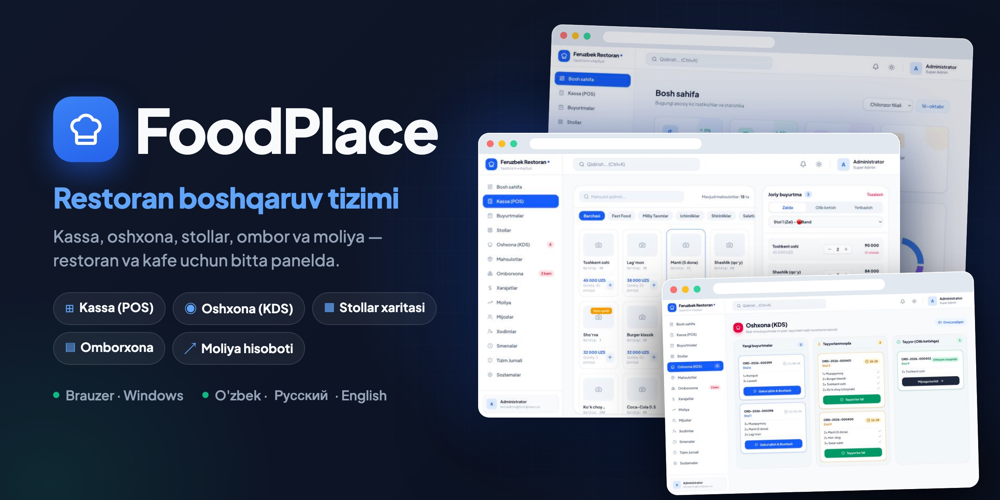

# FoodPlace — Restoran boshqaruv tizimi

[](https://github.com/Feruzbek0318/foodplace-restoran/actions/workflows/ci.yml)
[](LICENSE)

Restoran va kafe uchun boshqaruv paneli: kassa (POS), oshxona ekrani (KDS), stollar xaritasi, mahsulotlar va omborxona, xarajatlar, moliya hisoboti, mijozlar, xodimlar, kassa smenalari va audit jurnali. Interfeys o'zbek, rus va ingliz tillarida.

> **Ikki rejim.** Firebase sozlanmagan bo'lsa, ilova oflayn ishlaydi: ma'lumotlar shu qurilma brauzerida saqlanadi. Firebase ulansa ([Bulut sinxronizatsiya](#bulut-sinxronizatsiya)), barcha qurilmalar — kassa, oshxona planshet, ofitsiant — bitta ma'lumot bilan real vaqtda ishlaydi. Batafsil: [Cheklovlar](#cheklovlar).

**Jonli demo:** https://feruzbek0318.github.io/foodplace-restoran/ — har bir tashrif buyuruvchining ma'lumotlari faqat o'z brauzerida saqlanadi.

## Yuklab olish

Tayyor ilovalar [Releases](https://github.com/Feruzbek0318/foodplace-restoran/releases/latest) sahifasida:

| Platforma | Fayl | O'rnatish |
|---|---|---|
| Windows 10/11 (64-bit) | `FoodPlace-1.1.0-windows-setup.exe` | O'rnatuvchini ishga tushiring. SmartScreen chiqsa: **Batafsil → Baribir ishga tushirish** (ilova imzolanmagan). |
| macOS 11+ (Intel va Apple Silicon) | `FoodPlace-1.1.0-macos.dmg` | DMG'ni oching va FoodPlace'ni **Applications** papkasiga torting. Birinchi marta: o'ng tugma bilan bosib **Open** tanlang. |
| Android 7.0+ | `FoodPlace-1.1.0-android.apk` | Telefon yoki planshetga yuklab oching; "Noma'lum manbalardan o'rnatish"ga ruxsat bering. |
| Manba kodi | `Source code (zip / tar.gz)` | Har bir relizga GitHub avtomatik qo'shadi. |

Har bir qurilmada ma'lumotlar shu qurilmaning o'zida saqlanadi. Boshqa qurilmaga o'tkazish uchun **Sozlamalar → zaxira nusxa** faylidan foydalaning.

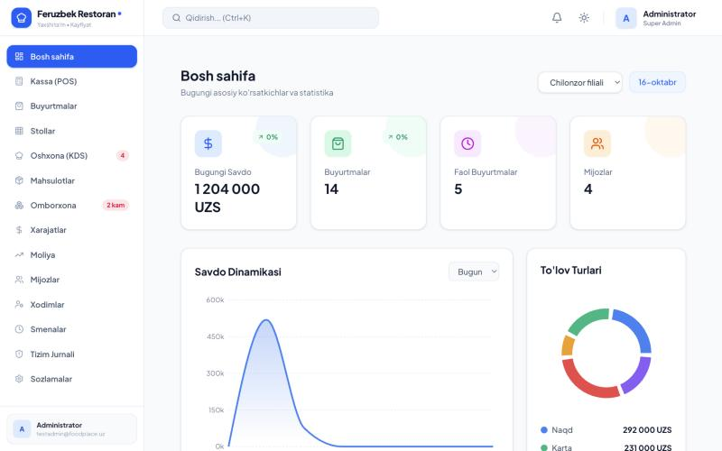

## Qanday ishlaydi

> Rasmlardagi taomlar, buyurtmalar va mijozlar — test rejimida kiritilgan namunaviy ma'lumotlar.

### 1. Birinchi ishga tushirish

Tizim birinchi marta ochilganda yangi restoran ochish yoki mavjud zaxira faylidan tiklash tanlanadi. Keyin 4 qadamda admin akkaunt, restoran va birinchi filial yaratiladi.

| Xush kelibsiz | Admin akkaunt yaratish |
|---|---|
| 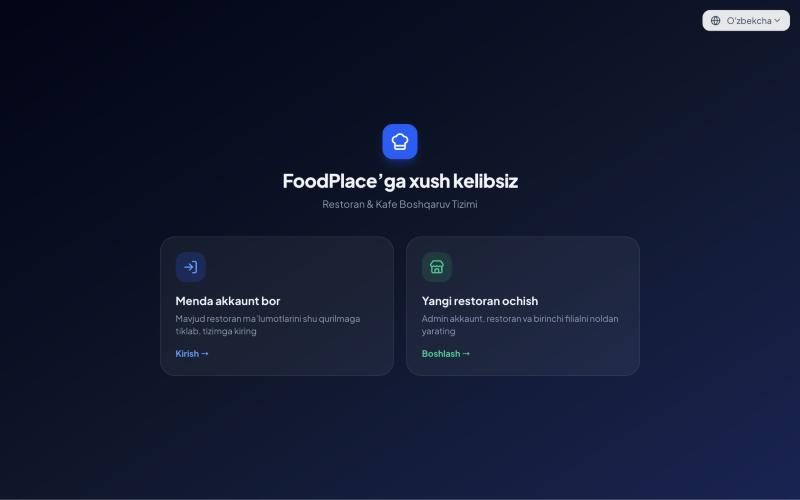 | 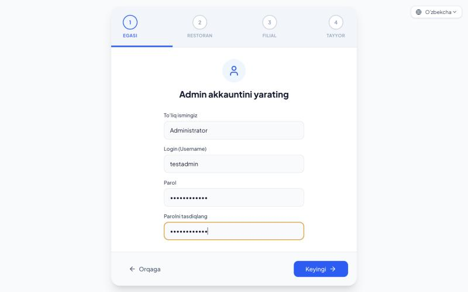 |

### 2. Kassa (POS)

Taomlar toifalar bo'yicha ko'rsatiladi; bosilgan taom savatga tushadi. Buyurtma turi (zalda, olib ketish, yetkazish), stol, chegirma va oshxona uchun izoh tanlanadi. To'lov usuli (naqd, karta, Click, Payme, Uzum yoki aralash) tanlanadi va chek chiqariladi; chekda buyurtma raqamining skanerlanadigan Code 128 shtrix-kodi bor. To'lov qabul qilish uchun kassa smenasi ochiq bo'lishi kerak.

> Click, Payme va Uzum bilan **integratsiya yo'q**: tizim to'lov usulini faqat qayd etadi (hisobot va smena uchun), pul o'tkazmasini o'zi amalga oshirmaydi.

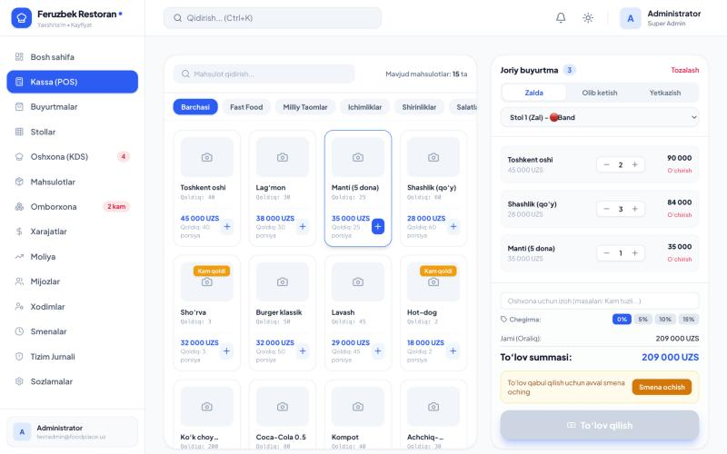

### 3. Stollar xaritasi

Zal, VIP va terrasa stollari rang bilan holatini ko'rsatadi: bo'sh (yashil), band (sariq), buyurtma kutmoqda, bron qilingan (ko'k). "Tahrirlash" rejimida stollarni sudrab joylashtirish mumkin.

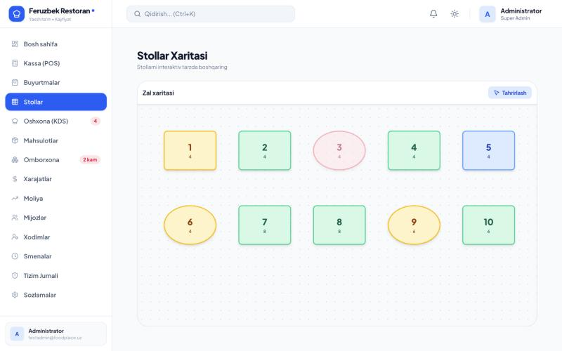

### 4. Oshxona ekrani (KDS)

Kassadan yuborilgan buyurtmalar oshxonada uch ustunda ko'rinadi: **Yangi → Tayyorlanmoqda → Tayyor**. Har bir kartada stol, taomlar va o'tgan vaqt taymeri bor; yangi buyurtma kelganda ovozli signal chalinadi.

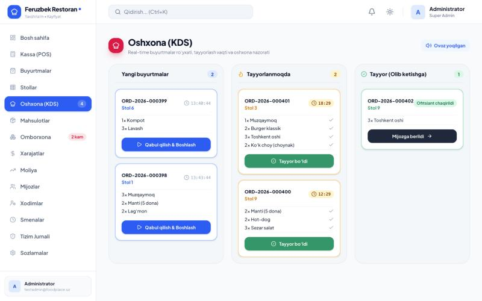

### 5. Buyurtmalar

Barcha buyurtmalar holati bo'yicha filtrlanadi (yangi, tayyorlanmoqda, tayyor, yopilgan, bekor qilingan), qidiriladi, chek qayta chop etiladi yoki bekor qilinadi.

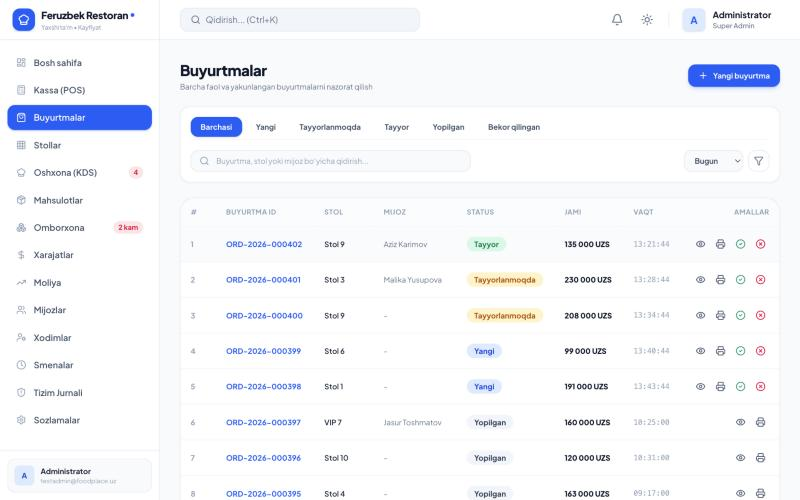

### 6. Moliya hisoboti

Tanlangan davr (bugun, hafta, oy, yil) bo'yicha tushum, buyurtmalar soni, o'rtacha chek va sof foyda (tushum − tannarx − xarajatlar) hisoblanadi; oldingi davrga nisbatan o'sish foizi, kunlik grafik va toifalar bo'yicha savdo ko'rsatiladi. Hisobotni CSV (Excel) ga yuklab olish mumkin.

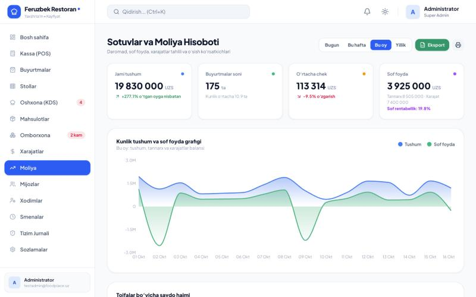

### 7. Omborxona va xarajatlar

Har bir sotuv ombordagi qoldiqni avtomatik kamaytiradi; minimal qoldiqdan kam qolgan mahsulotlar "Kam qoldi" deb belgilanadi. Kirim, chiqim va inventarizatsiya shu yerdan qilinadi. Ijara, ish haqi, kommunal va xomashyo xarajatlari alohida bo'limda yuritiladi va moliya hisobotiga qo'shiladi.

| Omborxona | Xarajatlar |
|---|---|
| 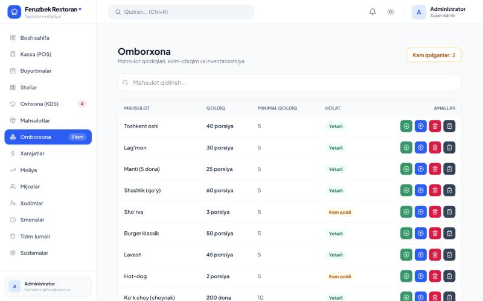 | 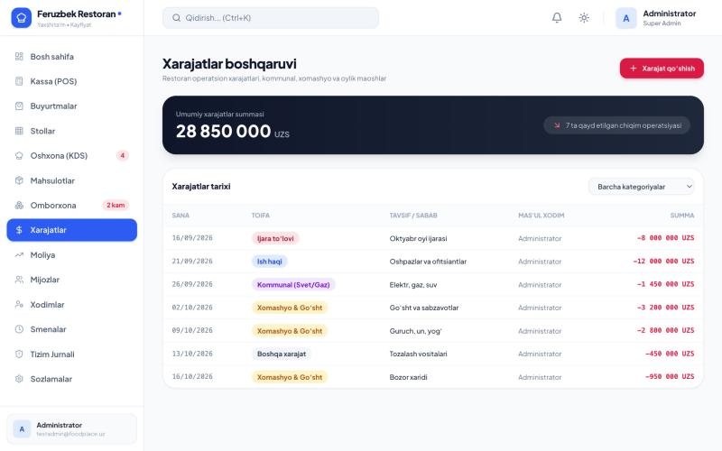 |

### 8. Mijozlar (CRM)

Doimiy mijozlar telefon raqami bilan saqlanadi; ularning buyurtmalar soni va umumiy xaridi avtomatik hisoblanadi.

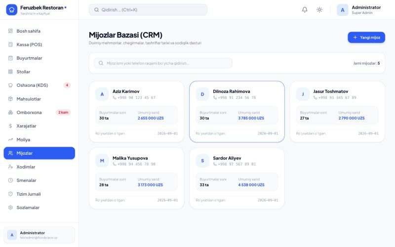

Shuningdek: **Xodimlar** (rollar va ruxsatlar), **Smenalar** (Z-hisobot, kassadagi naqd pul nazorati), **Tizim jurnali** (kim, qachon, nima qilgani), **Sozlamalar** (til, valyuta, soliq, mavzu, zaxira nusxa).

## Bulut sinxronizatsiya

Firebase (Google'ning bepul Firestore bazasi) ulansa:

- kassada berilgan buyurtma oshxona ekranida **1 soniyadan kam vaqtda** paydo bo'ladi, oshpaz "Qabul qilish"ni bossa kassada holat darhol o'zgaradi;
- xodim, mahsulot, narx, stol, ombor, smena va sozlamalardagi har bir o'zgarish barcha qurilmalarga yetib boradi;
- admin xodimni bloklasa yoki huquqini o'zgartirsa, u boshqa qurilmada darhol qo'llanadi (bloklangan xodim tizimdan chiqariladi);
- internet uzilsa ilova ishlashda davom etadi, o'zgarishlar navbatda turadi va ulanganda yuboriladi;
- ma'lumotlar Google serverida saqlanadi — brauzer tozalansa ham yo'qolmaydi.

**Ishlatish:**
1. Egasi (Super Admin): **Sozlamalar → Bulut → Bulutga ulash**. Shu qurilmadagi barcha ma'lumotlar bulutga yuklanadi va 32 belgili **restoran kaliti** chiqadi.
2. Yangi qurilmada: **Xush kelibsiz → Menda akkaunt bor → Restoran kaliti bilan ulanish** → kalitni kiriting → xodim o'z login va paroli bilan kiradi.
3. Yuqori o'ngdagi bulut belgisi holatni ko'rsatadi: yashil — onlayn, sariq — internet yo'q, qizil — xato.

### Firebase'ni sozlash (bir marta, ~5 daqiqa, bepul)

1. https://console.firebase.google.com → **Add project** (Google Analytics shart emas).
2. **Build → Firestore Database → Create database** → joylashuv: `eur3` yoki yaqin region → **production mode**.
3. **Build → Authentication → Get started → Sign-in method → Anonymous → Enable**.
4. **Project settings → General → Your apps → Web (`</>`)** → ilovani ro'yxatdan o'tkazing va `firebaseConfig` qiymatlarini oling.
5. Loyiha papkasida `.env.example` dan nusxa olib `.env.local` yarating va to'ldiring:
   ```bash
   VITE_FIREBASE_API_KEY=...
   VITE_FIREBASE_AUTH_DOMAIN=...firebaseapp.com
   VITE_FIREBASE_PROJECT_ID=...
   VITE_FIREBASE_APP_ID=...
   ```
6. Xavfsizlik qoidalarini yuklang:
   ```bash
   npx firebase login
   npx firebase deploy --only firestore:rules --project <PROJECT_ID>
   ```
7. **Authentication → Settings → Authorized domains** ga saytingiz domenini qo'shing (masalan, `feruzbek0318.github.io`).
8. `npm run build` qilib qayta joylang. Firebase web sozlamalari ochiq bo'lishi mumkin — kirish `firestore.rules` bilan himoyalangan.

Bepul (Spark) tarifi limiti: kuniga 50 000 o'qish, 20 000 yozish, 1 GB joy — bitta restoran uchun odatda yetarli.

**Lokal sinov (internetsiz, haqiqiy loyihasiz):** Java 21+ kerak.
```bash
npm run emulators          # Firestore + Auth emulyatori
# .env.local: VITE_FIREBASE_PROJECT_ID=demo-foodplace va VITE_FIREBASE_EMULATOR=true
npm run dev
```
Ikki qurilmani `http://localhost:3000` va `http://127.0.0.1:3000` da ochib sinash mumkin (ularning brauzer xotirasi alohida).

## Cheklovlar

Bu loyiha hozircha bitta qurilmada ishlaydigan, serversiz ilova. Haqiqiy restoranda ishlatishdan oldin quyidagilarni bilish kerak:

- **Bulutsiz rejimda ma'lumotlar faqat brauzerda.** Brauzer tozalansa yoki qurilma almashsa, hammasi yo'qoladi. Himoya: bulutga ulash yoki **Sozlamalar → Tizim → Zaxira nusxa yuklab olish**.
- **Restoran kaliti — bu kirish kaliti.** Firestore qoidalari kalitsiz hech kimga restoranni ko'rsatmaydi, lekin kalitni bilgan qurilma barcha ma'lumotlarni (xodimlar parol xeshlari bilan) o'qiy va yoza oladi. Kalitni faqat ishonchli xodimlarga bering.
- **Rollar ilova ichida tekshiriladi.** Kassir/oshpaz cheklovlari ilova interfeysi va mantiqida ishlaydi; kalitga ega va DevTools'dan foydalana oladigan odam ularni chetlab o'tishi mumkin. To'liq server tomonidagi rol tekshiruvi uchun har bir xodimni Firebase Authentication'da alohida foydalanuvchi qilish kerak (rejada).
- **Bir vaqtdagi tahrir.** Ikki qurilma bir yozuvni (masalan, bitta buyurtmani) aynan bir vaqtda o'zgartirsa, oxirgisi saqlanadi. Ombor qoldig'i ham shu tarzda — bir nechta kassa bir mahsulotni bir soniyada sotsa, qoldiq farq qilishi mumkin.
- **To'lov tizimlari** (Click, Payme, Uzum) ulanmagan — faqat to'lov usuli belgisi.
- **Desktop ilovalar imzolanmagan** (Windows SmartScreen va macOS Gatekeeper ogohlantiradi).

Rejada: har bir xodim uchun alohida Firebase akkaunti va server tomonidagi rol tekshiruvi, ombor qoldig'ini tranzaksiya bilan kamaytirish.

## Ishga tushirish

Talab: Node.js 20+

```bash
npm install
npm run dev
```

So'ng brauzerda http://localhost:3000 ni oching. Birinchi ochilishda admin akkaunt, restoran va birinchi filialni yaratish oynasi chiqadi.

## Buyruqlar

| Buyruq | Vazifasi |
|---|---|
| `npm run dev` | Ishlab chiqish serveri (port 3000) |
| `npm run build` | `dist/` ga production build |
| `npm run lint` | TypeScript tekshiruvi |
| `npm test` | Testlar (Vitest): hisob-kitoblar (chegirma, soliq, qaytim, ombor, smena, moliya) va bulut sinxronizatsiyasi (o'zgarishlarni aniqlash, restoran kaliti) |
| `npm run emulators` | Lokal Firebase emulyatori (Firestore + Auth), Java 21+ kerak |
| `npm run electron` | Build qilib, desktop (Electron) ilova sifatida ochadi |
| `npm run build:windows` | Windows o'rnatuvchisi (EXE) → `desktop/installer/` |
| `npm run build:mac` | macOS DMG (Intel + Apple Silicon) → `desktop/installer/` |
| `npm run build:android` | Android APK (Capacitor) → `android/app/build/outputs/apk/release/` |

Windows va macOS fayllari macOS kompyuterda ham yig'iladi (electron-builder). Android uchun Android SDK va JDK 17+ kerak (`JAVA_HOME`, `ANDROID_HOME`). Ilova belgisi manbasi: `desktop/assets/src/icon.html`.

## GitHub Pages'ga joylash

Sayt `gh-pages` tarmog'idan beriladi. Yangilash uchun build qilib, `dist/` ichidagini shu tarmoqqa push qiling:

```bash
npm run build
cd dist && touch .nojekyll && git init -b gh-pages && git add -A && git commit -m deploy && git push -f https://github.com/Feruzbek0318/foodplace-restoran.git gh-pages && rm -rf .git
```

## Tuzilishi

- `src/services/store.ts` — ma'lumotlar va biznes mantiq (buyurtmalar, smenalar, ombor, xodimlar)
- `src/utils/calc.ts` — sof hisob-kitob funksiyalari (testlari: `calc.test.ts`)
- `src/utils/permissions.ts` — rollar, ruxsatlar va qaysi bo'lim kimga ko'rinishi
- `src/services/backup.ts` — zaxira nusxa olish va tiklash
- `src/services/cloudSync.ts` — bulut sinxronizatsiya: ulash, kalit bilan qo'shilish, real vaqt tinglash; `syncDiff.ts` — o'zgarishlarni aniqlash (testlari bilan)
- `src/services/firebase.ts` — Firebase ulanishi (`.env.local` dan), `firestore.rules` — server tomonidagi kirish qoidalari
- `src/components/views/` — har bir bo'lim sahifasi
- `src/locales/` — tarjimalar: `index.ts` (kalitlar, `tr()`), `phrases.ts` (iboralar), `dynamic.ts` (jurnal/bildirishnoma qoliplari)
- `desktop/` — Electron qobig'i: Windows va macOS o'rnatuvchi sozlamalari
- `android/` — Capacitor orqali Android ilova (`capacitor.config.ts`)

## Banner

`docs/banner.jpg` (README) va `docs/social-preview.png` (GitHub Social preview, 1280×640) [docs/banner/banner.html](docs/banner/banner.html) faylidan yasalgan. Ekran rasmlari yangilansa, qayta suratga oling:

```bash
"/Applications/Google Chrome.app/Contents/MacOS/Google Chrome" --headless=new --hide-scrollbars --allow-file-access-from-files --virtual-time-budget=4000 --window-size=1280,640 --screenshot=docs/social-preview.png "file://$PWD/docs/banner/banner.html"
```

## CI

Har bir push va pull request'da GitHub Actions TypeScript tekshiruvi, testlar va build'ni ishga tushiradi ([.github/workflows/ci.yml](.github/workflows/ci.yml)).

## Litsenziya

[MIT](LICENSE)
